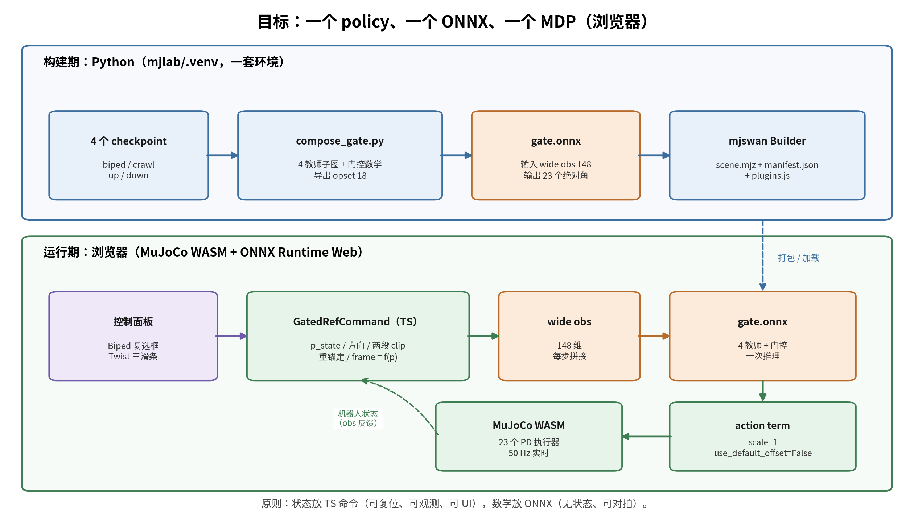
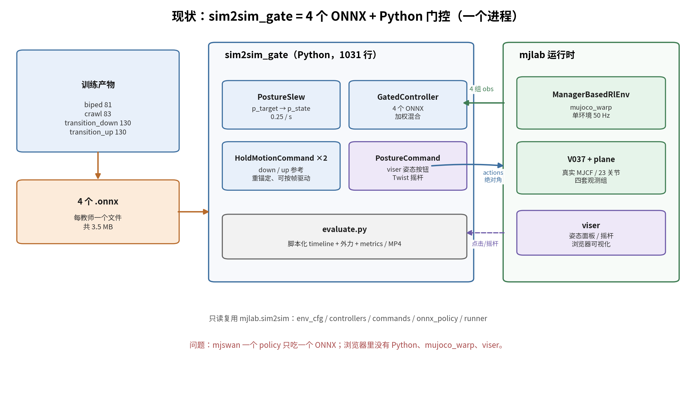
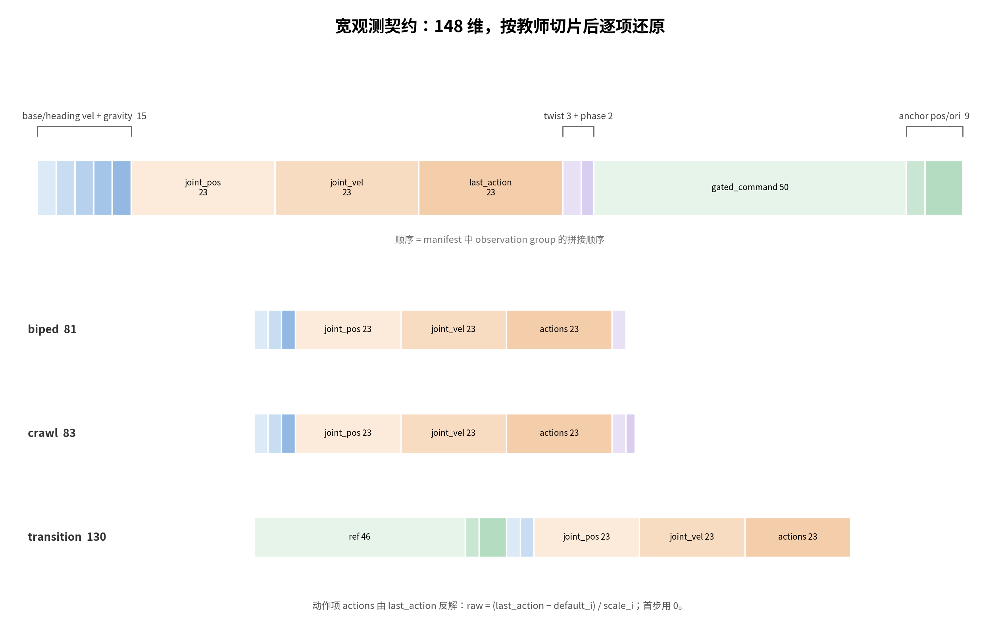
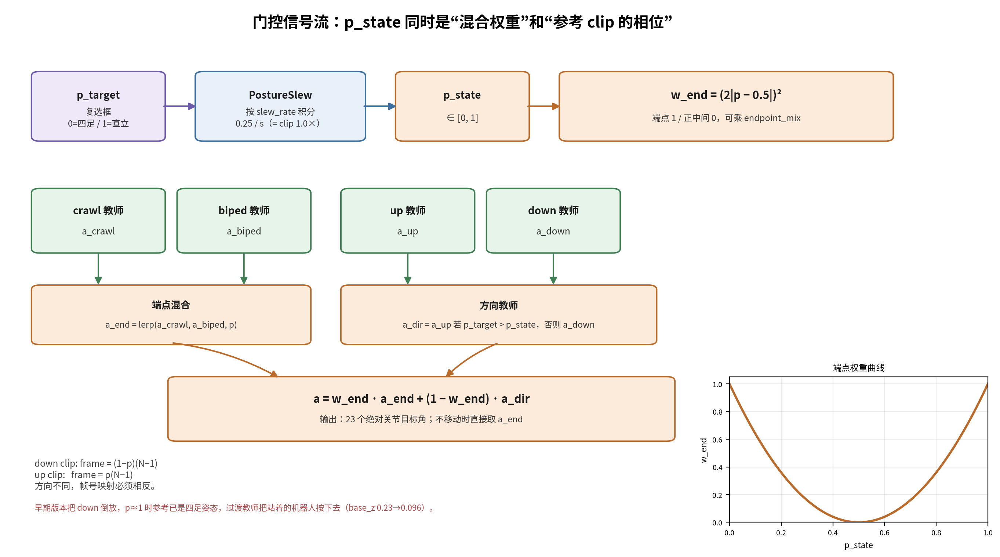
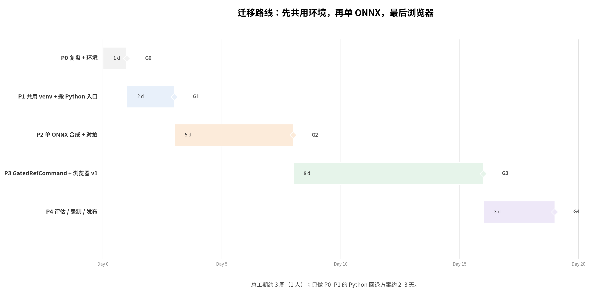
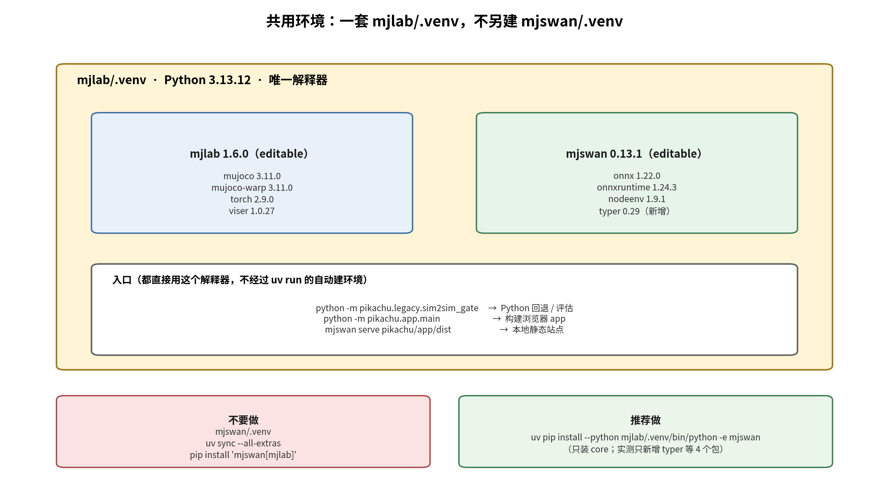
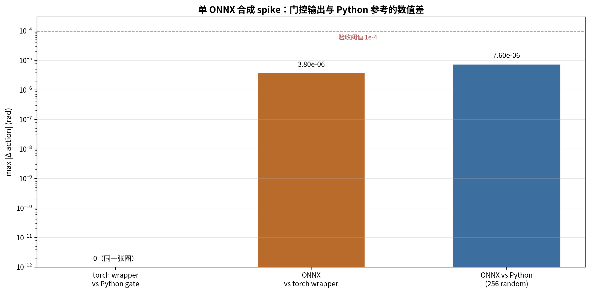

# 把 `sim2sim_gate` 迁进 mjswan：方案与实施计划

> 状态：方案文档（只做调研、代码阅读与离线 spike；没有改 mjlab / mjswan 的运行代码）
> 日期：2026-11-25
> `base_commit`（mjlab）：`6612b7f47b9fa65ca4f4d23e18966762d34e8851`
> `base_commit`（mjswan）：`2def7539`
> `spec_read`：`AGENTS.md`、`CONVENTIONS.md`、`mjlab/spec/agent-defaults.md`、
> `mjswan/AGENTS.md`、`mjswan/CONTEXT.md`、`mjswan/context/frontend.md`
> 说明：本任务不涉及训练、评估晋级或 pre_train 产物，所以没有读训练类 spec。
> 另外，mjswan 的 `AGENTS.md` 要求代码/注释用英文；这份**用户侧方案文档**按你的要求用中文，
> 未来落地的代码、注释、commit 仍用英文。

---

## 0. 一页纸结论

**一句话：不要“把 Python 脚本原样搬过去”。把四个教师 + 门控打包成一张 ONNX，再按
mjswan 的“一个 policy = 一个 ONNX”跑在浏览器里。**

打个比方：现在的 `sim2sim_gate` 像**四个老师各自交一份关节目标角，门控是裁判，按
`p_state` 把四份答案加权平均**。mjswan 的浏览器一次只能请一个老师（一个 ONNX），所以要把
四个老师和裁判一起装进同一张试卷（一张 ONNX），而不是把四个老师分别请进来。

**为什么不是直接搬 Python：**

- mjswan 的浏览器运行时是 **MuJoCo WASM + ONNX Runtime Web**，没有 Python、没有
  `mujoco_warp`、没有 viser。
- mjswan 的 `policy` 只加载**一个** ONNX；`setPolicy` 是“换一个策略”，不是“同时跑四个再混合”。
- `sim2sim_gate` 依赖 `mjlab.sim2sim` 的 `env_cfg / controllers / commands / onnx_policy /
  runner`，这些可以在构建期用，但运行期不在浏览器里。

**为什么这件事现在能做：**

- 四个 ONNX 在 `src/mjlab/sim2sim/models/`（已入库）；biped/crawl 的 checkpoint 在
  `pre_train/`，两个 transition 的 checkpoint 在 `logs/`（不入库，换机器要先取回）。
- 我做了离线 spike：把四个教师 MLP + 门控数学合成**一张 3.58 MB 的 ONNX**，输入宽观测
  148 维、输出 23 个绝对目标角；256 组随机输入下，与 Python 参考的最大差
  **7.6e-6 rad**（验收线 1e-4）。门控本身没有训练成本。
- mjlab 的 venv 与 mjswan 的核心依赖几乎完全对齐；实测只差一个 `typer`（见 §4）。

**工期（1 人）：**

| 范围 | 内容 | 时间 |
| --- | --- | --- |
| 只把 `sim2sim_gate` 入口搬出 mjlab、行为不变 | P0 + P1：共用 venv，Python 入口照旧跑 viser；`mjlab.sim2sim` 仍是只读依赖 | 2–3 天 |
| 浏览器 demo（推荐） | P0–P4：单 ONNX + 自定义 TS 命令 + 浏览器 v1 + 评估 | 约 3 周 |

**必须先说清楚的三个风险：**

1. **浏览器物理不是 mujoco_warp**：mjswan 跑 MuJoCo WASM，和 mjlab 的 `mujoco_warp`
   不是同一套积分/接触实现；图级对拍能保证“策略算得一样”，不能保证“机器人走得一样”。
2. **自定义 TS 命令是 trusted-only**：mjswan Cloud 会拒绝带 `uses_custom_js` 的文档；
   本地 `mjswan serve` 和 GitHub Pages 可以。
3. **过渡 clip 的尾巴问题仍在**：两段 clip 的四足端点 `tail_pitch` 与稳态差 0.785 rad。
   迁移只保证“行为一致”，不修这个问题；要修得回到数据/训练侧（见现有 README 与调研文档）。



*图 0：目标架构。构建期用共用的 mjlab venv 把四个教师合成一张 ONNX；运行期浏览器里由
一个自定义 TS 命令持有姿态/参考状态，ONNX 只做无状态的加权数学。*

---

## 1. 现状：`sim2sim_gate` 到底是什么

### 1.1 它解决的问题

V037 有四个已训好的策略：

| 控制器 | 任务 | 观测维度 | 动作 | 默认位姿 |
| --- | --- | --- | --- | --- |
| `biped` | `Mjlab-Velocity-Flat-Pikachu-V037-Biped-Upright-Head` | 81 | 23 | 直立 keyframe |
| `crawl` | `Mjlab-Velocity-Flat-Pikachu-V037-Crawl-Omni-Head-Up` | 83 | 23 | 四足 reset 位姿 |
| `transition_down` | `Mjlab-Tracking-Flat-Pikachu-V037-Down` | 130 | 23 | 直立 keyframe |
| `transition_up` | `Mjlab-Tracking-Flat-Pikachu-V037-Up` | 130 | 23 | 直立 keyframe |

四个模型的**动作语义一致**：`absolute_target = default_i + raw_i * scale_i`，都是 23 个
绝对关节目标角，但每个教师的 `default` / `scale` 不同。`sim2sim_gate` 的核心就是：

```
w_end = (2·|p − 0.5|)²                       # 端点 1，正中间 0
a_end = lerp(a_crawl, a_biped, p)             # 两个稳态教师插值
a_dir = a_up   if p_target > p_state          # 起立方向
        a_down if p_target < p_state          # 趴下方向
a     = w_end · a_end + (1 − w_end) · a_dir
```

`p_state` 是 `p_target ∈ {0,1}` 经过 `PostureSlew` 限速积分后的连续值（默认 0.25/s，
4 s 走完），它同时是**参考 clip 的相位**：

```
down clip: frame = (1 − p) · (N − 1)
up   clip: frame = p · (N − 1)
```

两段 clip 都是 **200 帧 @ 50 Hz = 4.0 s**，所以 0.25/s 正好让相位每控制步前进一个 clip 帧
（1.0× 播放），过渡教师看到的观测分布和训练时一致。

### 1.2 代码与依赖

| 文件 | 作用 |
| --- | --- |
| `sim2sim_gate/gating.py`（450 行） | `PostureSlew`、`endpoint_weight`、`gated_action`、`GatedController`、`reference_frame` |
| `sim2sim_gate/runner.py`（226 行） | 构建 env + 四个 ONNX session；viser / native / headless 三种入口 |
| `sim2sim_gate/evaluate.py`（308 行） | 脚本化 timeline + 可选外力 + metrics CSV / MP4 |
| `sim2sim_gate/README.md` | 设计、实测、两个“真跑才发现的坑” |
| `sim2sim_gate/__main__.py` | `python -m mjlab.sim2sim_gate` |

它只读复用 `mjlab.sim2sim`：

| 模块 | 被门控用到的内容 |
| --- | --- |
| `sim2sim/env_cfg.py` | `make_sim2sim_env_cfg()`：一台 V037、四套观测组、`twist` / `motion_down` / `motion_up` / `posture` 命令 |
| `sim2sim/controllers.py` | 四个教师的 `obs_group`、`default_joint_pos`、`action_scale`、ONNX 路径 |
| `sim2sim/commands.py` | `HoldMotionCommand`（可按住、重锚定、不瞬移）、`PostureCommand`（请求寄存器） |
| `sim2sim/onnx_policy.py` | onnxruntime CPU 推理与维度校验 |
| `sim2sim/runner.py` | `resolve_device()` 等小工具 |

### 1.3 为什么不能直接搬

| 需求 | `sim2sim_gate` 现在怎么做 | mjswan 有什么 | 结论 |
| --- | --- | --- | --- |
| 跑物理 | Python + `mujoco_warp` | 浏览器 + MuJoCo WASM | 物理实现不同，不能逐位复现 |
| 跑策略 | Python `onnxruntime`，4 个 session | ORT Web，**一个 policy 一个 session** | 必须合成一张 ONNX，或改 mjswan 核心 |
| 姿态状态 | Python `PostureSlew` + 命令项 | 只有命令项/UI，状态要自己实现 | 用一个自定义 TS 命令持有状态 |
| 参考 clip | Python `HoldMotionCommand`，可手动设帧 | 内置 `TrackingCommand` 自动按 fps 播放，切换时会写 sim 状态 | 需要自定义 TS 命令，或上游扩展 |
| UI | viser 按钮/摇杆 | React 控制面板，slider/checkbox/button | checkbox + 三滑条可覆盖 |
| 评估录制 | `evaluate.py` + mjlab recorder | 无内置视频录制 | Python 侧保留评估；浏览器另做录屏 |



*图 1：现在的运行形态：一个 Python 进程里同时有四个 ONNX、门控和 mujoco_warp；viser 只是
显示层。*

---

## 2. 目标架构：一个 ONNX + 一个 TS 命令

### 2.1 三句话

1. **一个 policy、一个 ONNX、一个 MDP**：四个教师子图和门控数学都在同一张 ONNX 里。
2. **状态放 TS 命令**：`p_target`、`p_state`、方向、当前 clip 帧、重锚定偏移、首步标记，
   全部由一个自定义 TS 命令持有；它每控制步更新，并把这些值暴露成观测 slot。
3. **ONNX 只做无状态数学**：给定宽观测 148 维，输出 23 个绝对目标角。这样 ONNX 可以
   离线对拍，浏览器只负责“把观测拼出来、把动作发下去”。

### 2.2 宽观测契约（148 维）

把四个教师训练时的观测“并集”拼成一个宽向量，再在 ONNX 里按教师切片。顺序就是
manifest 里 observation group 的拼接顺序：

| 段 | 宽度 | 来源 | 谁用 |
| --- | --- | --- | --- |
| `base_lin_vel_sensor` | 3 | `robot/imu_lin_vel` | biped / transition |
| `base_ang_vel_sensor` | 3 | `robot/imu_ang_vel` | biped / transition |
| `base_lin_vel_heading` | 3 | `heading_lin_vel`（crawl） | crawl |
| `base_ang_vel_heading` | 3 | `heading_ang_vel`（crawl） | crawl |
| `projected_gravity` | 3 | `projected_gravity` | biped / crawl |
| `joint_pos` | 23 | 绝对关节角 | 全部（图内减各自 default） |
| `joint_vel` | 23 | 绝对关节速度 | 全部（default_vel=0） |
| `last_action` | 23 | 上一步策略输出（绝对目标角） | 全部（图内反解 raw） |
| `twist` | 3 | 速度命令 `vx, vy, wz` | biped / crawl |
| `crawl_phase` | 2 | `sin/cos` 步态相位 | crawl |
| `gated_command` | 50 | `p_target, p_state, first_step, direction` + 参考 `46` | transition / 门控 |
| `motion_anchor_pos_b` | 3 | 参考锚点在机器人锚点系 | transition |
| `motion_anchor_ori_b` | 6 | 参考锚点姿态的 6D 表示 | transition |

实现上尽量**直接从四个训练 env_cfg 的 actor group 取 `term.func` 与 `params`**，不要
重新手写 `heading_lin_vel`、`phase_observation` 这类任务自定义项；只有 `joint_pos`
（改成绝对角）和 `last_action`（改成策略输出）需要换语义。

一共 **148 维**。三个教师切片：

| 教师 | 切片 | 宽度 |
| --- | --- | --- |
| `biped` | sensor 速度（6）+ gravity（3）+ `joint_pos` + `joint_vel` + `last_action` + `twist` | 81 |
| `crawl` | heading 速度（6）+ gravity（3）+ `joint_pos` + `joint_vel` + `last_action` + `twist` + `crawl_phase` | 83 |
| `transition_*` | `gated_command[4:50]`（46）+ anchor pos（3）+ anchor ori（6）+ sensor 速度（6）+ `joint_pos` + `joint_vel` + `last_action` | 130 |



*图 2：148 维宽观测与三个教师切片的对应关系。颜色只表示“来自哪一段”，不是四个教师的
独立输入。*

两个关键细节：

- **每个教师必须看到自己的 `actions` 观测**。门控没有单一 raw action，所以用上一步
  **实际施加的绝对目标角**反解：
  `raw_i = (last_action − default_i) / scale_i`。这一步不做，四个教师的 `actions` 恒为 0，
  过渡教师会看到训练时从未出现过的输入，动作会发散（现有 README 的“坑 2”）。
- **首步用 0**。`GatedController.reset()` 把四个 `_previous_raw` 清零；浏览器里
  `last_action` 在 reset 后也是 0。如果图里直接算 `(0 − default)/scale`，会得到一个很大的
  伪 raw。用 `first_step` 标记在首步把 raw 置 0。

### 2.3 门控信号流



*图 3：`p_state` 既是混合权重 `w_end` 的输入，也是参考 clip 的相位；方向由
`p_target − p_state` 的符号决定。*

### 2.4 门控超参与“过渡期零速”

- `endpoint_mix`、`endpoint_sharpness` 在导出时作为**常量**写进 ONNX；v1 用默认值
  （1.0 / 2），不放进 ONNX 输入。要改就重新导出，保证图与 Python 版同参。
- `zero_twist_in_interior` 在 ONNX 图里实现：`moving = |p_target − p_state| > eps` 时，
  把 `twist` 和 `crawl_phase` 两段乘 0 再喂教师。这样不需要 TS 命令去改另一个命令项
  （`CommandTermContext` 里没有 command manager 的引用）。
- 如果 v1 发现“过渡期零速”不是必须，可以用 CLI 参数导出 `zero_twist=False` 的版本，
  不改代码。

### 2.5 动作与关节顺序

- 动作项：`JointPositionActionCfg`，`scale=1.0`、`use_default_offset=False`、`clip=None`、
  `actuator_names=POLICY_ACTION_JOINT_NAMES`。
- 为什么 `scale=1`：门控输出已经是**绝对目标角**；如果再乘一次 scale，会二次缩放。
- 关节顺序：V037 的 `POLICY_ACTION_JOINT_NAMES` 与模型关节顺序**完全一致**（已核对，
  23/23 相同），所以 mjswan 按模型顺序解析不会换序。
- `clip_actions`：不要设。rsl-rl 的 raw action clamp 在这里不适用；门控输出是绝对角，
  设了会把目标角硬夹到 ±clip。
- `policy_joint_names`：填 23 个关节名；`default_joint_pos` 填直立默认位姿（`use_default_offset=False`
  时动作不依赖它，但元数据和后续工具会读，填对可避免误导）。

### 2.6 参考 clip、相位与重锚定

- 两段 clip 都在 `mjlab/src/mjlab/mocap/npz/`：`Pikachu-V037-Transition-Down.npz`、
  `Pikachu-V037-Transition-Up.npz`，各 200 帧 @ 50 Hz。
- **不要直接把 mjswan 的 `TrackingCommand` 当门控命令用**：
  - 它的 `startEpisode()` 会调用 `applyReferenceStateToSim()`，在切换/重置时把参考写进
    仿真（瞬移）；`sim2sim` 的 `HoldMotionCommand` 正是为了避开这个。
  - 它按 `fps` 自动推进帧，没有“由 `p_state` 手动设帧”的接口。
- 自定义 TS 命令需要复刻 `HoldMotionCommand` 的三件事：
  1. **重锚定**：方向切换时，把整段参考按机器人的当前 yaw/位置平移旋转，使得
     `frame` 的锚点 = 机器人当前锚点；
  2. **手动帧**：`frame = reference_frame(p, N, direction)`，每控制步按 `p_state` 写入；
  3. **不写 sim**：只更新参考，不调用写 qpos 的接口。
- 命令项命名为 `motion`：mjswan 运行时会把它注入成 `config.commands.motion.motions`，
  TS 命令从 `config.motions` 拿两段 clip 的字节和 `anchor_body_name`/`body_names`。
- **时序**：mjswan 的 `CommandManager.update()` 在控制步**末**调用；门控的 `p_state`
  必须在观测读取**前**推进，才能和 sim2sim 的 `PostureSlew.step()`（策略调用前）对齐。
  把 `step()` 放在 `getCommand()`/`getStateField()` 的首次读取里（用 `mjData.time` 或
  步计数去重），不要只放在 `update()`；否则相位会慢一个控制步（20 ms）。
- **构建期要有一个 Python stub**：`generated_commands`、`motion_anchor_pos_b`、
  `motion_anchor_ori_b` 是 traced 观测，tracing 时读的是 `env_cfg` 里的命令项。需要一个
  Python `GatedRefCommand`（继承 `HoldMotionCommand`，`getCommand()` 也返回 50 维，补
  `posture_state`/`first_step` 等属性）作为 trace-time 命令；浏览器侧跑 TS 版。
  `getCommand()` 的宽度必须和 stub 一致；TS 的 `getStateField()` 要覆盖 tracing 记录到的
  每一个 command slot（字段名逐一对应），否则图会对不上。
- 为了少一个命令名，trace env 里把 `motion_down` 改名成 `motion`（两段 clip 都挂在
  `policy.motions`，由 TS 命令选）；这样 `generated_commands(command_name="motion")` 和
  `motion_anchor_*` 都能解析。
- 已知限制（不修）：四足端点 `tail_pitch` 与稳态差 0.785 rad；门控本身连续，视觉上只是
  一次快速小甩尾。迁移保持现状，修复要回到 clip 生成/重训。

### 2.7 UI

- **Biped 复选框**：勾选 = `p_target=1`，取消 = 0。mjswan 的 checkbox 是命令项的一个
  input，天然有值、可复位、可观测。
- **Twist 三滑条**：`vx, vy, wz`。可以直接用 mjswan 的 `velocity_command()` 预设。
- **姿态按钮暂不做**：mjswan 的 `triggerButton` 目前只处理 `zero`；两个“起立/趴下”按钮
  需要改上游 UI 或自定义命令，v1 用 checkbox 足够。
- 不建议用 mjswan 的 motion 下拉框手动切 clip：它只切“当前播放的 clip”，不负责
  `p_state` 与重锚定，容易和门控状态打架。

### 2.8 构建产物

`Builder.build()` 会写出：

```
pikachu/app/dist/
  index.html, assets/...
  manifest.json
  <project>/<scene>/
    scene.mjz
    mdp/<mdp-id>/{obs,term,command,event,action}/*.onnx
    policy/<policy-id>.onnx          # 合成后的 gate.onnx
    assets/*.npz                    # 两段参考 clip
  assets/plugins.js                 # 自定义 TS 命令（uses_custom_js=true）
```

---

## 3. 路线对比：为什么选“单 ONNX + 浏览器”

| 路线 | 做法 | 交付 | 工作量 | 主要风险 | 建议 |
| --- | --- | --- | --- | --- | --- |
| **A. 单 ONNX + 浏览器** | 4 教师 + 门控合成一张 ONNX；自定义 TS 命令持有状态 | 浏览器 demo，一个 policy | 8–12 天 | 图合成、浏览器物理差异、自定义 TS | **推荐** |
| B. Python 桥接 | 代码搬进 `mjswan/pikachu/legacy`，继续用 mjlab env + viser | 和现在一样的 viser 工具 | 2–3 天 | 几乎无 | **作为 A 的 Phase 1 / 回退** |
| C. 4 策略切换 | 浏览器里四个 policy，按钮切换 | 浏览器 demo | 3–4 天 | 失去连续过渡，切换会“抽一下” | 不推荐 |
| D. 给 mjswan 加多策略/集成 policy | 改 manifest + runtime，支持多 ONNX 混合 | 通用能力 | 3–4 周 | 上游设计/评审；仍要任务特定门控 | 不推荐 |

为什么不做 D：mjswan 的 manifest、`PolicyRunner`、`OnnxModule`、`action` 路径都假设
“一个 policy 一个 ONNX”。加“多网络 + 混合”是核心架构改动，收益却只服务这一个任务；
而单 ONNX 方案不需要改 mjswan 核心，还能把“方案 C”真正落成**一个文件、一个接口**。



*图 4：分阶段路线。P2 的核心风险（四个教师能否合成一张 ONNX）已经在 spike 中验证，
见 §7.2。*

---

## 4. 共用 mjlab 的 uv 环境

### 4.1 版本矩阵（实测）

| 包 | `mjlab/.venv` 实际 | mjswan 要求 | 结论 |
| --- | --- | --- | --- |
| Python | 3.13.12 | `>=3.11` | ✅ |
| `mujoco` | 3.11.0 | `==3.11.0` | ✅ 精确匹配 |
| `mujoco-warp` | 3.11.0 | 不依赖（只用 mjlab） | ✅ |
| `torch` | 2.9.0 | 只有 `[mjlab]` extra 要求 `>=2.9.1` | ⚠️ **不要装 extra** |
| `onnx` | 1.22.0 | `>=1.20.0` | ✅ |
| `onnxruntime` | 1.24.3 | 不在 core deps；转换/对拍需要 | ✅ 已有 |
| `rich` | 14.2.0 | `>=13.0.0` | ✅ |
| `typer` | 未安装 | `>=0.12.0` | ⚠️ 安装时自动补 |
| `nodeenv` | 1.9.1 | `>=1.9.1` | ✅ |
| `viser` | 1.0.27 | 不依赖 | ✅ |

### 4.2 安装命令（实测 dry-run）

在 `pikachu_playground/` 下：

```bash
uv pip install --python mjlab/.venv/bin/python -e ./mjswan
```

实测 `--dry-run` 输出：

```
Resolved 26 packages in 5.48s
Would download 3 packages
Would install 4 packages
 + annotated-doc==0.0.7
 + mjswan @ file:///.../mjswan
 + shellingham==1.5.4
 + typer==0.29.2
```

也就是说：**只新增 4 个包，不动 torch / mujoco / mujoco-warp / onnx / onnxruntime**。

### 4.3 不要做的事

| 不要做 | 原因 |
| --- | --- |
| 在 `mjswan/` 里 `uv sync --all-extras` | 会创建 `mjswan/.venv`，重复装 torch/CUDA，且可能改 mujoco 版本 |
| `pip install 'mjswan[mjlab]'` | extra 要求 `torch>=2.9.1`，会把 2.9.0 升级；CUDA 轮子可能跟着变 |
| 用 `uv run python ...`（在 mjswan 目录） | `uv run` 会按 mjswan 的 `pyproject` 自动建/同步环境，不是共用 mjlab venv |
| 把 mjswan 的依赖写进 mjlab 的 `pyproject.toml` | 会让 mjlab 反向依赖 mjswan；共用环境应该只改 venv，不改 mjlab 的依赖声明 |

推荐做法：

```bash
# 所有命令都用同一个解释器；cwd 在 mjswan/ 下，pikachu 才是可导入的包
cd mjswan
../mjlab/.venv/bin/python -m pikachu.legacy.sim2sim_gate   # Phase 1
../mjlab/.venv/bin/python -m pikachu.app.main              # Phase 3
../mjlab/.venv/bin/mjswan serve pikachu/app/dist           # 本地站点
```

### 4.4 前端 Node

- mjswan 的构建期用 `nodeenv` 拉 **Node 24.19.0** 到 `src/mjswan/template/.nodeenv/`；
  系统里即使有 Node 25 也不会用。
- 首次 `Builder.build()` 会 `npm install`，需要网络；之后走缓存。
- 这只是**构建期**成本；浏览器运行期不需要 Node。

### 4.5 可复现性

- 记录 `uv pip freeze > pikachu/env/freeze.txt`（或只记录关键包版本）。
- 固定 `mjswan` 到当前 commit（或 tag），不要用 `main` 浮动。
- 固定 `mjlab` 到 `6612b7f...`；如果 mjlab 后续改了 `sim2sim`，Phase 1 会先暴露。
- 可选：写 `pikachu/env/check_env.py`，检查 Python/mujoco/torch/onnx 版本与
  `import mjswan`，在构建前跑一遍。



*图 5：一套 `mjlab/.venv` 同时装 mjlab 与 mjswan；所有入口直接用这个解释器。*

---

## 5. 代码落位

建议目录（都在 `mjswan/` 下，不碰 `src/mjswan`）：

```
mjswan/pikachu/
  README.md                         # 入口、前置条件、运行命令
  doc/
    sim2sim_gate_migration_plan_20261125.md
    assets/                         # 本文的图 + make_figures.py
  env/
    check_env.py                   # 版本/导入检查
  legacy/
    sim2sim_gate/                  # Phase 1：从 mjlab 复制的 Python 版（行为不变）
      __main__.py
      gating.py
      runner.py
      evaluate.py
  gate/
    obs_contract.py                # 148 维布局、切片、每教师 default/scale
    compose.py                     # 4 教师 + 门控 -> 单 ONNX（PyTorch wrapper + export）
    ref_command.py                 # trace-time Python stub + GatedRefCommandCfg
    parity.py                      # 随机/闭环对拍
  app/
    main.py                        # mjswan Builder 装配
    gated_ref_command.ts           # 自定义 TS 命令（两段 clip、p_state、重锚定）
  eval/
    evaluate_gate.py               # Python 评估（复用 legacy）
    compare_browser.py             # 浏览器录制/对比（Phase 4）
```

注意事项：

- 每个包目录加 `__init__.py`（`pikachu/`、`legacy/`、`gate/`、`app/`、`eval/`），
  并从 `mjswan/` 目录执行 `python -m ...`，否则 `pikachu` 不在 `sys.path`。
- **不要**在 mjswan 仓库根建一个叫 `mjswan/` 的子目录：会 shadow 掉安装的包。
- `pikachu/` 是 author-side 项目，不修改 `src/mjswan`；如果确实需要“手动帧控制的
  tracking command”这种通用能力，单独给 mjswan 提 PR，不把任务特定逻辑塞进核心。
- 判断标准：如果 `GatedRefCommand` 与 `TrackingCommand` 的重复代码超过 ~300 行，优先提
  一个通用的小 PR（暴露 `setFrame` / `setSelectedMotion`、且不写 sim），而不是继续复制；
  但 v1 不被 PR 阻塞，作者侧版本先跑。
- 代码/注释/commit 用英文（mjswan `AGENTS.md`）；本文用中文是用户要求。

---

## 6. 分阶段实施

### P0 · 复盘 + 环境（1 天）

- 记录 mjlab / mjswan 的 `base_commit`、四个 ONNX 的 SHA-256、四个 checkpoint 的路径。
- 在 mjlab venv 里安装 mjswan core（§4.2），确认：

  ```bash
  mjlab/.venv/bin/python -c "import mjswan; print(mjswan.__version__)"
  ```

- 跑一次基线：

  ```bash
  cd mjlab
  .venv/bin/python -m mjlab.sim2sim_gate --viewer none --max-steps 560 \
      --script "20:quad,300:biped"
  ```

  保存日志/base_z 曲线，作为后续对拍基准。

**G0**：环境导入成功；560 步脚本能跑完；基线日志与 README 一致。

### P1 · 共用 venv + 搬 Python 入口（2 天）

- 把 `sim2sim_gate` 复制到 `pikachu/legacy/sim2sim_gate`，改成包内相对导入；外部仍
  `from mjlab.sim2sim...`（Phase 1 不复制 `sim2sim`）。
- 入口：`cd mjswan && ../mjlab/.venv/bin/python -m pikachu.legacy.sim2sim_gate`。
- 复制 `evaluate.py` 到 `pikachu/eval/evaluate_gate.py`（或先保留在 legacy 里）。
- 跑 `pytest`：把 `tests/test_sim2sim_gate.py` 的纯函数测试搬过来。

**G1**：同一 seed、同一脚本、同一 device 下，560 步的动作序列与 mjlab 版**逐位一致**
（或差异 < 1e-6）；`base_z` 曲线一致；纯函数测试全过。

### P2 · 单 ONNX 合成 + 对拍（3–5 天）

- `obs_contract.py`：从 `build_controller_specs()` 生成每教师 `default/scale` 和切片，
  不手写常量；加单元测试，保证宽向量拼出来与 env 的四组观测逐项一致。
- `compose.py`：
  - 用 `build_torch_actor()` 从四个 checkpoint 重建 `as_onnx()` 模型；
  - 写一个 `nn.Module`，输入宽观测，内部切片、反解 raw、跑四个 MLP、做门控；
  - `torch.onnx.export(..., opset_version=18, dynamo=False)`，输出一张 ONNX；
  - 写入 metadata（任务、joint names、obs layout、checkpoint SHA）。
- `parity.py`：
  - 随机宽观测：ONNX vs Python `gated_action`，1 万组，max abs(Δ) < 1e-4；
  - 闭环：用同一段脚本、同一 seed，Python 版与“ONNX 替换门控”版逐步对比动作/base_z。
- **spike 已完成的部分**（见 §7.2）：四教师 + 门控合成、148 维宽观测、256 组随机对拍，
  max 7.6e-6；所以 P2 剩下的主要是“把真实观测拼进来 + 闭环”。

**G2**：随机对拍 < 1e-4；闭环 560 步动作 max abs(Δ) < 1e-3；base_z 差 < 1 mm。

### P3 · 自定义 TS 命令 + 浏览器 v1（5–8 天）

- **3a. Python 装配**：
  - `env_cfg = make_sim2sim_env_cfg()`；在 `add_scene_mjlab` 之前把
    `env_cfg.commands["motion_down"]` 换成 `GatedRefCommandCfg`（trace env 读的是
    scene 持有的 `env_cfg`，policy 上的 `commands=` 只影响浏览器 MDP）。
  - `ProjectHandle.add_scene_mjlab(task_id, env_cfg=env_cfg)`；
    `task_id` 用 `Mjlab-Tracking-Flat-Pikachu-V037-Down`（只为 attribution/runner 默认值，
    实际 term 全部显式传）。
  - `add_policy(..., observations=wide_group, actions=absolute_action,
    commands={"twist": velocity_command(), "motion": gated_ref_cfg},
    policy_joint_names=POLICY_ACTION_JOINT_NAMES,
    in_keys=None, out_keys=["actions"])`。
  - `policy.add_motion(name="transition_down", source=..., anchor_body_name=...,
    body_names=..., dataset_joint_names=..., loop=False)`；再 add 一个 up。
- **3b. 注册自定义 TS 命令**（Python 侧，字段按实际 cfg 填）：

  ```python
  mjswan.register_command(
      "GatedRefCommandCfg",
      mjswan.CommandBinding(
          ts_name="GatedRefCommand",
          ts_src=str(HERE / "gated_ref_command.ts"),
          serializer=lambda cfg: {"ui": ..., "motions": ...},
      ),
  )
  ```
- **3c. 实现自定义 TS 命令**：
  - 解析两个 `.npz`（`mjswan/npz` 的 `loadNpz`）；
  - 读 checkbox 的 `p_target`，每控制步更新 `p_state`/方向/帧；
  - 方向切换时做重锚定；
  - `getCommand()` 返回 `[p_target, p_state, first_step, direction, ref(46)]`；
  - `getStateField()` 提供 `anchor_pos_w / anchor_quat_w / anchor_lin_vel_w /
    anchor_ang_vel_w / robot_anchor_pos_w / robot_anchor_quat_w` 等；
  - `getUiConfig()` 声明 Biped checkbox；
  - `reset()` 回到起始状态（p_state/帧），不写 sim；清 first_step。
- **3d. 构建/调试**：
  - `cd mjswan && ../mjlab/.venv/bin/python -m pikachu.app.main` → `dist/`；
  - `mjswan info dist` 检查：1 个 MDP、1 个 policy、graph 数量非 0、两段 clip 都在；
  - 浏览器里测：切姿态、给速度、复位、50 Hz 实时、无 console error。

**G3**：浏览器能连续切 biped↔quad；切换无瞬移；不摔；稳态 base_z 与 Python 版同脚本差 < 2 cm；
页面稳定 50 Hz。

### P4 · 评估 / 录制 / 发布（2–3 天）

- Python 侧保留 `evaluate.py`（metrics/CSV/MP4）作为参考评估。
- 浏览器侧：用 headless Chrome / Playwright 录屏，或人工录屏 + ffmpeg；对比同脚本的
  base_z/姿态曲线。
- 写 `pikachu/README.md`：前置条件（Node 下载、网络）、运行命令、已知差异。
- 可选发布：GitHub Pages 可以；Cloud 会因为 `uses_custom_js=true` 拒绝。

**G4**：干净 clone + 共用 venv 能复现构建；README 能让人从零跑起来；已知差异写清楚。

---

## 7. 验收与对拍

### 7.1 验收表

| 层级 | 检查 | 通过线 |
| --- | --- | --- |
| 观测契约 | 宽向量重拼四组观测 vs env 实际观测 | max abs(Δ) < 1e-6 |
| 图级 | ONNX vs Python 门控（随机宽观测） | max abs(Δ) < 1e-4 |
| 闭环 | 560 步脚本，ONNX 版 vs Python 版动作 | max abs(Δ) < 1e-3 |
| 闭环 | base_z 曲线 | max abs(Δ) < 1 mm |
| 浏览器 | 姿态切换、速度、复位 | 无瞬移、无 console error |
| 浏览器 | 实时性 | 稳定 50 Hz（或说明降级） |
| 交付 | `mjswan info dist` | 1 policy、graph > 0、两段 clip |
| 交付 | 干净环境重建 | 按 README 可复现 |

### 7.2 已完成的 spike（2026-11-25）

用 mjlab venv 的 torch 2.9 + onnx 1.22 + onnxruntime 1.24，做了两个离线实验：

1. **四教师 + 门控合成**：四个 `as_onnx()` 模型 + `lerp/where/pow`，导出 opset 18；
   `torch` wrapper vs Python `gated_action` = 0.0；ONNX vs torch = 3.8e-6。
2. **148 维宽观测**：按 §2.2 的布局切片、减 default、反解 raw，再跑四教师 + 门控；
   256 组随机输入下 ONNX vs Python：**max 7.6e-6，p50 1.9e-6，p99 6.7e-6**；
   合成 ONNX **3.58 MB**。

3. **本机只读装配检查**（没有 build 前端）：
   - `add_scene_mjlab("...V037-Down", env_cfg=make_sim2sim_env_cfg())` 成功，
     `control_dt=0.02`；只出现 “2 keyframes, only the first will be used” 警告。
   - `add_policy(biped.onnx, observations=cfg.observations["biped"], actions=cfg.actions)`
     能解析；不传 `policy_joint_names` 时它是 0（`policy_num_actions=23`），所以显式传
     23 个关节名更稳。
   - 如果把 `cfg.commands["twist"]` 直接传给 mjswan，会因为它实际是
     `HeadingHoldVelocityCommandCfg`（不是 `UniformVelocityCommandCfg`）而被 warn + skip。
     所以浏览器 MDP 里必须用 `velocity_command()`；trace env 保留原命令。



*图 6：spike 的数值差。门控本身是同一张图，所以 torch wrapper 与 Python 参考完全一致；
ONNX 与 torch 的差异来自浮点路径，远低于 1e-4 验收线。*

这些数字说明：**“四教师 + 门控 → 一张 ONNX”没有算法/数值障碍**。剩下的风险主要在
“真实观测拼接、浏览器命令/物理”。

### 7.3 已验证 / 未验证

| 项 | 状态 | 证据 |
| --- | --- | --- |
| mjlab venv 版本 | ✅ 已验证 | `uv pip list`：Python 3.13.12 / mujoco 3.11.0 / torch 2.9.0 / onnx 1.22 / onnxruntime 1.24.3 |
| mjswan 装入 mjlab venv | ✅ 已验证（dry-run） | 只新增 4 个包，不动 torch/mujoco |
| `add_scene_mjlab` 接受 sim2sim env_cfg | ✅ 已验证 | `control_dt=0.02`，仅 2 keyframes 警告 |
| `add_policy` 解析单教师 ONNX | ✅ 已验证 | biped.onnx + biped obs + actions=23 |
| 四教师 + 门控合成单 ONNX | ✅ 已验证（spike） | 256 组随机，max 7.6e-6 |
| 148 维宽观测切片 | ✅ 已验证（spike） | 随机宽向量下切片/门控与 Python 参考一致；真实 env 观测的逐项对齐在 P2 |
| 浏览器 trace / build | ❌ 未验证 | P3 的主要工作 |
| 自定义 TS 命令 | ❌ 未验证 | P3 的主要工作 |
| 浏览器物理行为 | ❌ 未验证 | G3 用行为对比 |
| Cloud 拒绝 `uses_custom_js` | 📄 依据文档 | mjswan `context/frontend.md` |

---

## 8. 风险与对策

| 风险 | 影响 | 对策 |
| --- | --- | --- |
| 浏览器 MuJoCo WASM vs `mujoco_warp` | 同一策略动作不同、可能摔 | 图级对拍只保证策略；闭环用“行为对比”而不是逐位；必要时调 PD/摩擦/步长；保留 Python 版作参考 |
| 自定义 TS 命令不能在 Cloud 发布 | 不能一键发 Cloud | 本地/Pages 交付；若必须 Cloud，把参考逻辑做成 traced command（难）或接受 4 策略切换（不推荐） |
| `TrackingCommand` 会写 sim 状态 | 切换瞬移 | 自写 `GatedRefCommand`，只更新参考、不写 qpos；或给 mjswan 提“手动帧”PR |
| 观测契约漂移 | 教师输入错、行为崩 | 从 `build_controller_specs()` 生成常量；单测逐项对比 env 观测；不要手写 23 个 default |
| transition checkpoint 只在 `logs/`（不入库） | 换机器无法重导/重合成 | 先按 `spec/training-environment.md` 取回 run；或 fallback 到“从现有 ONNX 图组合”，不依赖 checkpoint |
| `heading_lin_vel`/`phase_observation` 等任务自定义 obs 不能 trace | 构建失败 | 在 `pikachu/terms.py` 写等价 traceable 函数，`register_observation` 注册；只改可追踪性，不改数学 |
| 首步 `last_action=0` 被反解成伪 raw | 开局动作异常 | 自定义命令暴露 `first_step`；图里首步 raw=0；加 reset 测试 |
| clip 尾巴 0.785 rad | 端点保真/蒸馏受影响 | 迁移不修；记录为已知差异；另开数据/训练任务 |
| Node 24.19 下载失败 | 构建失败 | 预拉 `.nodeenv`；文档写清网络要求；CI 缓存 |
| mjswan 版本漂移 | manifest/runtime 变化 | 固定 commit/tag；升级单独任务 |
| `mjswan[mjlab]` 升级 torch | CUDA/驱动不匹配 | 只装 core；需要转换时用 mjlab 已有 torch |
| 浏览器接触/arena 上限 | 四足自碰撞接触多，可能溢出 | 先在浏览器跑 transition，观察 console；必要时 `mt=True`/减少自碰撞 |
| 评估/录制缺失 | 无法出报告 | Phase 1 保留 Python `evaluate.py`；浏览器另做录屏；不混为一谈 |

---

## 9. 需要你拍板的事

这些问题不影响先做 P0–P2，但会影响 P3/P4 的范围：

1. **交付目标**：本地 demo、GitHub Pages、还是 mjswan Cloud？
   Cloud 会拒绝自定义 TS（`uses_custom_js`），如果必须 Cloud，路线要改。
2. **是否接受两阶段**：先 P1 的 Python 回退（2–3 天），再 P2/P3 浏览器？
   我建议接受：P1 能立刻把代码搬出 mjlab，且给 P2 提供对拍基准。
3. **UI**：Biped checkbox 够不够？还是必须两个“起立/趴下”按钮（需要改 mjswan UI）？
4. **评估**：是否保留 `evaluate.py` 的 metrics/MP4 口径？如果保留，Python 侧会长期存在。
5. **mjlab 里的旧代码**：迁移完成后是删除 `src/mjlab/sim2sim_gate/`，还是保留一个
   deprecation shim？我建议先复制、对拍通过后再删，且删除单独 commit。

---

## 10. 附录

### A. 源码索引

| 内容 | 位置 |
| --- | --- |
| 门控公式/状态/控制器 | `mjlab/src/mjlab/sim2sim_gate/gating.py` |
| 运行入口 | `mjlab/src/mjlab/sim2sim_gate/runner.py` |
| 评估录制 | `mjlab/src/mjlab/sim2sim_gate/evaluate.py` |
| 现状说明与实测 | `mjlab/src/mjlab/sim2sim_gate/README.md` |
| sim2sim 环境配置 | `mjlab/src/mjlab/sim2sim/env_cfg.py` |
| 四教师规格 | `mjlab/src/mjlab/sim2sim/controllers.py` |
| 可按住参考/姿态命令 | `mjlab/src/mjlab/sim2sim/commands.py` |
| mjswan 的 policy 概念 | `mjswan/src/mjswan/policy.py` |
| mjswan 的 scene.add_policy | `mjswan/src/mjswan/scene.py` |
| mjswan 的 add_scene_mjlab | `mjswan/src/mjswan/project.py` |
| 浏览器 policy 推理 | `mjswan/src/mjswan/template/src/core/engine/runtime.ts`（`runOnnxInference`） |
| 浏览器 tracking 命令 | `mjswan/src/mjswan/template/src/core/command/TrackingCommand.ts` |
| 构建管线/轨迹 env | `mjswan/src/mjswan/build/pipeline.py` |
| 官方迁移 skill | `mjswan/skills/mjlab-to-mjswan/SKILL.md` |

### B. spike 命令

```bash
cd mjlab
.venv/bin/python /tmp/gate_wide_spike.py
.venv/bin/python /tmp/gate_parity_spike.py
```

（脚本是临时 spike，不随本文提交；核心逻辑见 §2.2/§2.3，落地时放进
`pikachu/gate/compose.py` 与 `pikachu/gate/parity.py`。）

### C. 重新生成图

```bash
cd mjlab
.venv/bin/python ../mjswan/pikachu/doc/assets/make_figures.py
```

脚本只依赖 matplotlib；图里的数字（spike 结果）是 2026-11-25 的实测值。

### D. 环境 dry-run 输出

```text
$ uv pip install --python mjlab/.venv/bin/python --dry-run -e ./mjswan
Resolved 26 packages in 5.48s
Would download 3 packages
Would install 4 packages
 + annotated-doc==0.0.7
 + mjswan @ file:///home/finnox/Pikachu/PikachuRobot/pikachu_playground/mjswan
 + shellingham==1.5.4
 + typer==0.29.2
```

### E. 名词表

| 名词 | 含义 |
| --- | --- |
| 教师 / teacher | 四个已训好的策略之一（biped/crawl/up/down） |
| 绝对目标角 | `default_i + raw_i * scale_i`，23 个关节角，四个教师共享的物理空间 |
| `p_target` | 用户请求的姿态：0 四足、1 直立 |
| `p_state` | 限速积分后的连续姿态，同时是 clip 相位 |
| `a_end` | 两个稳态教师的插值 |
| `a_dir` | 当前方向的过渡教师输出 |
| 重锚定 | 把参考 clip 整体平移到机器人当前锚点，只取 yaw/位置，不写 sim |
| 宽观测 | 148 维并集，按教师切片后逐项还原 |
| 单 ONNX | 四个教师子图 + 门控数学合成的一张图，对外一个 policy |

---

## 结论（TL;DR）

- **推荐**：P1 先把 Python 版搬进 `mjswan/pikachu/legacy`、共用 mjlab venv（2–3 天）；
  然后 P2 把四教师 + 门控合成一张 ONNX（3–5 天，spike 已证明可行）；最后 P3 用自定义
  TS 命令做浏览器 v1（5–8 天）。
- **不推荐**：把四个 ONNX 直接搬进 mjswan 浏览器（运行时只支持一个 policy），或给
  mjswan 加通用的多策略混合（3–4 周，收益不匹配）。
- **先做 P0/P1 就能拿到确定收益**：`sim2sim_gate` 入口离开 mjlab、环境只剩一套、行为
  不变（`mjlab.sim2sim` 仍是只读依赖）；浏览器是增量，不影响现有评估。
