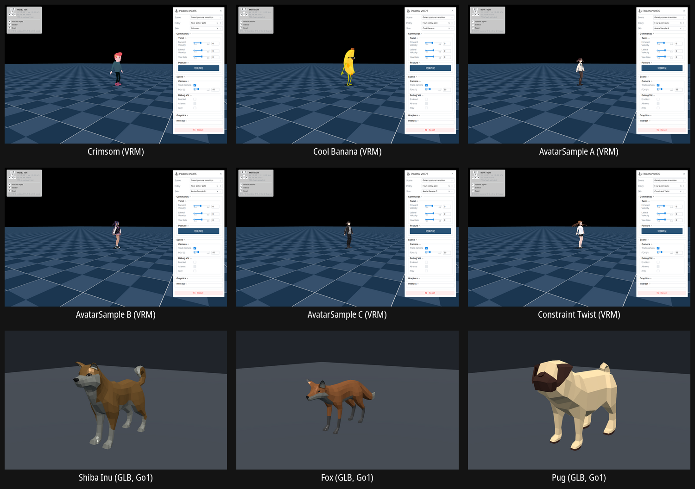
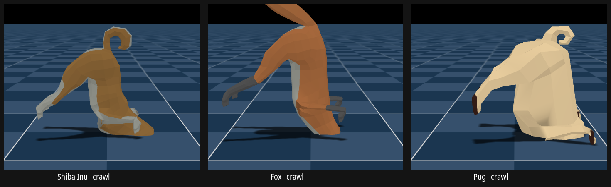
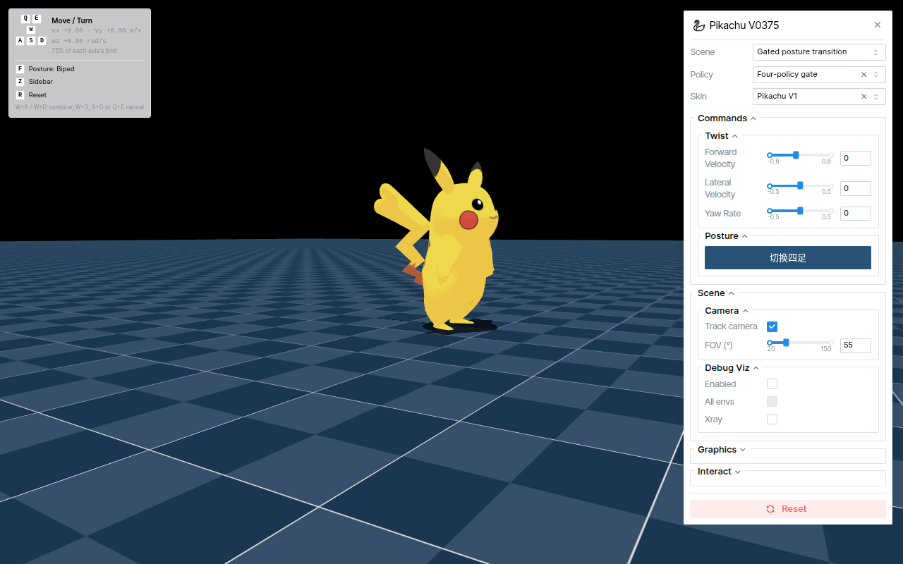
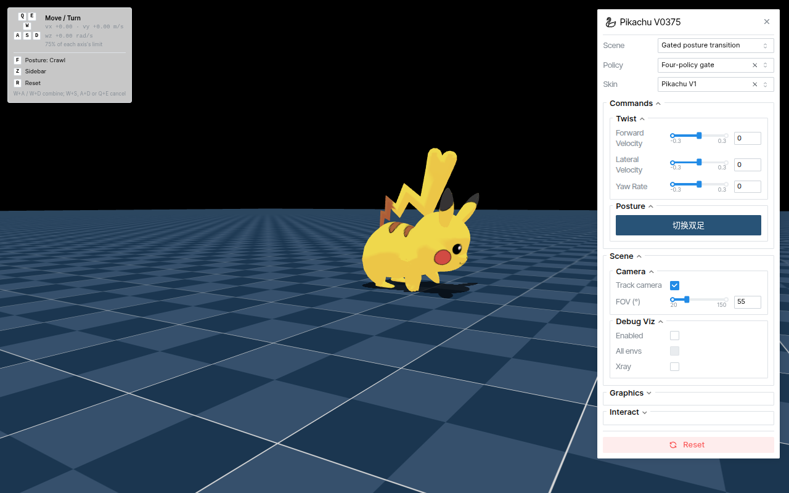

# Pikachu 浏览器场景的 VRM 皮套：规范与制作流程

> 状态：皮套实验记录；代码、文档与截图提交在 `pikachu_skin` 分支，VRM/GLB 资产因授权
> 只放在本地 `pikachu/.cache/skins/`（git 忽略）
> 日期：2026-11-26
> `base_commit`（mjlab）：`52fb34a5a5e88ad73b104ef3ce3be0d1b5c59a94`
> `base_commit`（mjswan）：`8af732cd`（`pikachu_skin` 从此分支切出）
> `spec_read`：`AGENTS.md`、`CONVENTIONS.md`（workspace）、`mjswan/AGENTS.md`、
> `mjswan/context/frontend.md`、`mjswan/context/skins.md`
> 说明：mjswan 要求代码和注释用英文；这份**用户侧文档**按你的要求用中文写，落地代码
> （`pikachu/browser/avatar_skin.py` 等）仍然是英文。

---

## 0. 一页纸结论

**人形 VRM 可以直接套到皮卡丘上，骨骼映射已经跑通；唯一的硬坑是尺寸。**

- VRM 的单位是米，一个普通头像约 1.5–1.8 m，而皮卡丘约 0.5 m 高。
- mjswan 对 VRM **不允许设 `scale`**，`height_ratio` 只调整根骨骼离地高度，不缩放模型，
  所以直接把 1.6 m 的头像挂上来会是一个“巨人”（见
  [自然尺寸截图](assets/vrm_avatar_natural_size.png)）。
- 解决办法：**让皮套本身就是皮卡丘大小**。本次实验用一个本地脚本，把 VRM 骨架根节点的
  `scale` 按“头顶高度归一”写成 0.32–0.43（文件仍是合法 VRM，three-vrm 和 mjswan 都能读），
  效果见 [九宫格总览](assets/skins/contact_sheet.png)。结果是手、脚、头都能跟着机器人走，
  W 键行走时步态跟随正常。
- 云端 `skins/` 一共 9 个文件（6 个 VRM + 3 个四足 GLB），全部下载并截图，见第 1.6 节。
- 皮套同时加在 **Gated posture transition** 和 **Biped walking** 两个场景；默认场景是
  **Gated posture transition**，默认皮肤是 **Crimsom**（文件名排序第一个）。

正式制作时更推荐**在 Blender 里直接按目标身高建模/缩放后导出**，不要依赖这种节点缩放补丁。

---

## 1. 本地实验做了什么

### 1.1 资产（云端全部 9 个）

来源：Hugging Face `ttktjmt/mjswan` 的 `skins/`；本地在 `pikachu/.cache/skins/`
（`.cache` 已被 git 忽略，不会误提交）。

| 文件 | 类型 | 大小 | 许可 |
| --- | --- | --- | --- |
| `100avatars/100Avatars_001_Crimsom.vrm` | VRM 0.x | 1.6 MB | CC0 1.0 |
| `100avatars/100Avatars_024_CoolBanana.vrm` | VRM 0.x | 1.5 MB | CC0 1.0 |
| `pixiv/AvatarSample_A.vrm` | VRM 0.x | 21 MB | pixiv 样例（随文件 meta） |
| `pixiv/AvatarSample_B.vrm` | VRM 1.0 | 21 MB | pixiv 样例（随文件 meta） |
| `pixiv/AvatarSample_C.vrm` | VRM 0.x | 20 MB | pixiv 样例（随文件 meta） |
| `pixiv/VRM1_Constraint_Twist_Sample.vrm` | VRM 1.0 | 10.8 MB | pixiv 样例（随文件 meta） |
| `pikachu/vrm/pikachu_v1.vrm`（仓库内） | VRM 0.x | 471 KB | 自建皮卡丘皮套（meta: Other） |
| `quaternius/shiba_inu.glb` | GLB（四足） | 0.85 MB | CC0 1.0 |
| `quaternius/fox.glb` | GLB（四足，带尾巴 spring） | 0.96 MB | CC0 1.0 |
| `quaternius/pug.glb` | GLB（四足） | 70 KB | CC0 1.0 |

注：pixiv 样例不能当 CC0 用；本实验只作本地预览，文件放在被忽略的 `.cache`。

### 1.2 代码位置

- [pikachu/browser/avatar_skin.py](../browser/avatar_skin.py)：骨骼映射表 `PIKACHU_BONES`、
  缩放副本生成 `scaled_copy()`、`add_avatar_skins()`。
- [pikachu/browser/main.py](../browser/main.py)：新增 `--skin <file.vrm | 目录>`（可重复）
  和 `--out <dir>`；皮套挂到 **Gated posture transition** 与 **Biped walking** 两个场景。

### 1.3 映射表

机器人没有躯干关节，所以 `hips` 到 `neck` 全部跟 `base_link`；每条腿/胳膊的“上段骨骼”
映射到**该关节链最深的那个 link**，这样 pitch/roll/yaw 三个关节的旋转都会被带上：

| VRM humanoid 骨骼 | 皮卡丘 body | 说明 |
| --- | --- | --- |
| `hips` / `spine` / `chest` / `neck` | `base_link` | 没有脊柱关节，躯干整体跟 base |
| `head` | `head_yaw_link` | 取 head_pitch + roll + yaw 的合成旋转 |
| `leftUpperArm` / `rightUpperArm` | `arm_yaw_link` | 肩上三段（pitch/roll/yaw）的合成 |
| `leftLowerArm` / `rightLowerArm` | `elbow_link` | 肘关节 |
| `leftHand` / `rightHand` | `elbow_link` | 没有腕关节，手跟随小臂 |
| `leftUpperLeg` / `rightUpperLeg` | `hip_yaw_link` | 髋三段（pitch/roll/yaw）的合成 |
| `leftLowerLeg` / `rightLowerLeg` | `knee_link` | 膝关节 |
| `leftFoot` / `rightFoot` | `ankle_link` | 踝关节；没有脚趾骨骼 |

> 规则：**骨骼要映射到“能把它的所有旋转都带上”的那个 body**。例如上臂如果映射到
> `arm_pitch_link`，就会丢掉 arm_roll 和 arm_yaw。

### 1.4 姿态（rest pose）

- VRM 规范要求角色以 **T-pose**（双臂水平）为 rest。
- 皮卡丘的**零位**（所有关节为 0）经 FK 验证就是 T-pose：手臂水平伸展、腿垂直向下。
  所以 `rest_pose=None`（零位）即可，不需要手写关节角。
- 训练用的默认位姿手臂是放下的（`arm_roll ≈ ±0.925 rad`），那是**运行时姿态**，不影响
  皮套拟合。

### 1.5 实验结果

| 配置 | 观察 |
| --- | --- |
| 自然尺寸（`retarget` 默认 `hybrid`） | 映射正确、能走，但 1.6 m 的巨人，头部甚至出画 |
| 六个人形皮套（头顶统一到 0.5 m） | 整体约 0.65–0.8 m 高，站在机器人位置，手/脚/头跟随正常 |
| 行走（W 键斜坡到 0.6 m/s） | 双腿交替、手臂摆动，Twist 滑条同步显示 0.600 |

### 1.6 九个皮套一览



| 名称 | 类型 | 截图 |
| --- | --- | --- |
| Crimsom（默认） | VRM | [crimsom.png](assets/skins/crimsom.png) |
| Cool Banana | VRM | [cool_banana.png](assets/skins/cool_banana.png) |
| AvatarSample A | VRM | [avatarsample_a.png](assets/skins/avatarsample_a.png) |
| AvatarSample B | VRM | [avatarsample_b.png](assets/skins/avatarsample_b.png) |
| AvatarSample C | VRM | [avatarsample_c.png](assets/skins/avatarsample_c.png) |
| Constraint Twist | VRM | [constraint_twist.png](assets/skins/constraint_twist.png) |
| Shiba Inu | GLB（Go1 四足） | [shiba_inu.png](assets/skins/shiba_inu.png) |
| Fox | GLB（Go1 四足） | [fox.png](assets/skins/fox.png) |
| Pug | GLB（Go1 四足） | [pug.png](assets/skins/pug.png) |

### 1.7 四足皮套（crawl 姿态）

四足 GLB 也接进了 App，用和 Go1 demo 一样的映射：**前腿当手臂、后腿当腿**，并把
`rest_pose` 设成皮卡丘的 **crawl 初始关节角**（`build_controller_specs("crawl").default_joint_pos`），
让动物自己的四足站姿与机器人的四足姿态对齐。



| 名称 | 场景 | 截图 |
| --- | --- | --- |
| Shiba Inu | Gated + Quadruped crawling | [quad_shiba_inu.png](assets/skins/quad_shiba_inu.png) |
| Fox（带尾巴 spring） | Gated + Quadruped crawling | [quad_fox.png](assets/skins/quad_fox.png) |
| Pug | Gated + Quadruped crawling | [quad_pug.png](assets/skins/quad_pug.png) |

实现细节（[animal_skin.py](../browser/animal_skin.py)）：

- `humanoid` 用 Quaternius 的节点名（`POLY_PIZZA_HUMANOID` / `PUG_HUMANOID`），
  `reparent` 把 IK 脚挂到腿上，`springs` 给狐狸尾巴；
- `rest_pose` = crawl 初始姿态；`height_ratio` 手动设为「动物胯高 / 机器人根高 0.229」，
  否则 crawl 姿态下默认比值会把动物抬到空中；
- `scale` 按动物自身高度缩到约 0.30 m（crawl 时机器人身体约 0.26 m 高）。

> 注意：动物跟随的是皮卡丘的 crawl 姿态（双足机器人趴下），不是真正的狗步态。
> 柴犬/巴哥看起来接近趴姿；狐狸后腿长，会被机器人姿态放大成半立，属映射上限。
> 四足动物在 **Biped** 场景里也会出现（会站起来），正常用法是在 Gated 切到 crawl 或用
> **Quadruped crawling** 场景。

单独预览四足原始模型（不套机器人）仍可用 `pikachu/.cache/viewer/index.html`。

### 1.8 自建皮卡丘皮套 `pikachu_v1`

`pikachu/vrm/pikachu_v1.vrm` 是仓库内的自建皮卡丘皮套（VRM 0.x，471 KB），
本身就是**机器人尺度**（头顶约 0.25 m、最高 0.46 m），所以不做缩放：`avatar_skin.py` 的
`ROBOT_SCALE` 里的文件按原尺寸使用，不会生成 `_x*.vrm` 副本。




- 菜单名 **Pikachu V1**，URL `?skin=pikachu_v1`；
- 骨骼仍走 `PIKACHU_BONES`（hips→base、头→head_yaw、手臂/腿取最深 link）；
- `python -m pikachu.browser.main` 默认就会挂上它（`--no-skin` 可关闭）；
  额外加载云端皮套再传 `--skin pikachu/.cache/skins`。

它适合作为后续“皮卡丘皮套适配”的基线：改这个 VRM 的骨骼/权重/贴图，重新构建即可。

构建时 `add_skin` 还给出了定量提示：自然尺寸下 avatar 的四肢长度是机器人的
**3.32–3.74 倍**，所以 `retarget="position"` 会明显拉伸（不推荐）。

---

## 2. VRM 是什么（规范摘要）

### 2.1 容器

- VRM 就是一个 **glTF 2.0 binary（.glb）**，多了一个顶层扩展：
  - VRM 1.0：`extensions.VRMC_vrm`
  - VRM 0.x：`extensions.VRM`
- 文件必须**自包含**：buffers 和贴图全部内嵌，不能引用旁边的 `.bin` / 图片文件。
- 单位：**米**；坐标：Y 向上。
- 朝向：**VRM 1.0 面向 +Z；VRM 0.x 面向 -Z**（three-vrm / mjswan 会自动做半圈旋转）。

### 2.2 humanoid 骨骼

VRM 的核心是一套**标准命名的人形骨骼**，所有人形 VRM 都用同一套名字，所以动画、
重定向和换装可以通用。

- **必需**（VRM 1.0）：`hips`、`spine`、`head`、左右 `upperArm` / `lowerArm` / `hand`、
  左右 `upperLeg` / `lowerLeg` / `foot`。
- **可选**：`chest`、`neck`、`shoulder`、`toes`、手指、眼睛、下颌等。
- rest 姿态必须是 **T-pose**（手臂水平）。

这也就是为什么 mjswan 能用**一张** `bones` 映射表套任意 VRM：名字是统一的。

### 2.3 其它扩展

- **Spring bones**（`VRMC_springBone`）：头发、尾巴、裙摆的二级物理。每根骨骼有
  stiffness / drag / gravity 和碰撞体。
- **表情**（`VRMC_vrm.expressions`）：happy / angry / blink 等 preset 的 blend shape。
- **材质**：通常用 **MToon**（`VRMC_materials_mtoon`），二次元卡通着色。
- **LookAt**：眼球看向控制。
- **Meta / 授权**：`meta` 里写作者、版权、`licenseUrl`、`avatarPermission`、
  `commercialUsage`、`allowRedistribution`、`modification` 等。

### 2.4 VRM 0.x 与 1.0 的区别

| | VRM 0.x | VRM 1.0 |
| --- | --- | --- |
| 扩展名 | `VRM` | `VRMC_vrm` |
| 朝向 | -Z | +Z |
| 骨骼命名 | camelCase（`leftUpperArm`） | camelCase（同） |
| 授权字段 | `licenseName`、`allowedUserName` 等 | 更细的 `avatarPermission`、`commercialUsage`… |
| 新特性 | — | expressions / lookAt / springBone 结构化、更严格的 schema |

mjswan 两种都支持；demo 里的 pixiv 样本是 0.x/1.0 混合，本实验用的是 0.x。

### 2.5 授权

VRM 的授权**写在文件里**，构建和发布时会跟着文件走：

- mjswan 发布（`mjswan publish`）会拒绝“禁止再分发”的 VRM；
- 本地实验可以随便用，但**不要把没授权的 VRM 提交进 git**；
- 本实验用的 100Avatars 是 CC0，但截图和文件仍放在被忽略的 `.cache` 与 `doc/assets`。

---

## 3. mjswan 怎么驱动皮套

皮套是**纯渲染层**：物理、碰撞和策略仍然是机器人本体的，`hide_robot` 只是不画机器人。
[context/skins.md](../../context/skins.md) 有完整设计。

### 3.1 `SkinConfig` 关键字段

| 字段 | 作用 |
| --- | --- |
| `bones` | 骨骼 → 机器人 body；VRM 用 humanoid 名，GLB 可给 node 名 |
| `source` | `.vrm` / `.glb` 的本地路径或 URL；构建时**原样拷贝** |
| `humanoid` | 仅 GLB：humanoid 映射，或 preset `"mixamo"` |
| `limbs` | 仅 GLB：`(upper, lower, end)`，hybrid 模式据此做 IK |
| `rest_pose` | 角色处于自身 rest 时，机器人应摆的姿势；`None` = 零位 |
| `rest_offsets` | 机器人关节无法表达的额外角度（度） |
| `height_ratio` | 只缩放“根骨骼离地高度”，**不缩放模型整体** |
| `offset` / `hips_offset` | 整体平移 / 根骨骼在 body 内的偏移 |
| `hide_robot` | 画皮套时隐藏机器人；Xray 可透视检查 |
| `retarget` | `hybrid`（默认）/ `rotation` / `position` |
| `brightness` | MToon 颜色亮度补偿 |
| `mujoco_springs` | 用 MuJoCo 子模型算 spring bones（默认用 three-vrm） |

### 3.2 三种 retarget

- **`hybrid`（默认，推荐）**：每根骨骼按 body 的旋转转，保持角色比例；然后两骨 IK 把
  手/脚拉到机器人手/脚的位置。
- **`rotation`**：只旋转，不 IK；手/脚会出现偏差（G1 demo 用这个）。
- **`position`**：每根骨骼钉在 body 上，只有模型本身与机器人同比例时才合适，否则网格
  被拉伸/折皱（本实验自然尺寸下会拉伸 3 倍以上）。

### 3.3 构建期拟合

`add_skin` 在 Python 构建期就完成：

1. 读文件、检查格式/压缩；
2. 找每根骨骼、每个 body；
3. 按 `rest_pose` 计算每根骨骼的 rest offset；
4. 量出机器人根高度、hips 偏移（`hips_offset=None` 时自动居中）；
5. 把结果写进 manifest，浏览器只读索引和旋转。

### 3.4 限制（会直接报错）

- `.gltf`（外部资源）拒绝；Draco / meshopt / KTX2 压缩拒绝；
- VRM 只能用它自己的 humanoid、springs、`scale`、材质、授权，配置里设置这些会报错；
- VRM 的 `height_ratio` 是允许的，但它不缩放模型。

---

## 4. 制作流程（推荐路径）

### Step 0：选 VRM 还是 GLB

- **人形角色 → 优先 VRM**：骨骼名标准化、自带 spring bones 和授权。
- 四足 / 非人形 / 需要自定义缩放 → `.glb` + `humanoid`（或 `limbs`）+ `scale`。

### Step 1：Blender 里准备模型

1. 建模/绑定，确保是**人形骨架**；Mixamo 骨骼也可以（GLB 用 `humanoid="mixamo"`）。
2. 摆成 **T-pose**（双臂水平）。
3. **单位按米**；若要套皮卡丘，直接把整体缩到 **≈ 0.65 m 高**（约原尺寸的 0.4），
   避免后面用节点缩放补丁。
4. 骨骼朝向、左右命名按 VRM 约定（VRM Add-on 会自动识别并映射）。

### Step 2：导出

用 **VRM Add-on for Blender**（VRM 1.0）导出 `.vrm`：

- 在 add-on 里设置 Humanoid 骨骼映射（大多可自动）；
- `Meta` 里填作者、许可、允许的用途；
- 压缩关闭（不要 Draco），贴图内嵌；
- 可选：配置 Spring Bone（头发/尾巴）、表情。

如果只需要 GLB：Blender 导出 **glTF 2.0 Binary**，`Data → Compression` 关闭，
贴图内嵌，然后：

```python
mjswan.SkinConfig(
    source="pikachu.glb",
    humanoid="mixamo",          # 或 {VRM bone: node name}
    scale=0.4,                  # 仅 GLB 允许
    material=mjswan.ToonShading(shade=0.6, toony=0.5),
    rest_pose=None,
)
```

### Step 3：写映射

把 humanoid 骨骼映射到机器人 body，规则：

- **根骨骼**（`hips`）负责位置；
- 每根骨骼映射到**包含其全部旋转的最深 body**（上臂 → 肩部最后一段、腿 → `hip_yaw`）；
- 机器人没有的关节，往上找最近的可映射 body（本实验的 `hand → elbow`）。

### Step 4：尺寸

- VRM：**在 Blender 里就缩好**，`source` 直接给。
- 实验性捷径（本次采用）：给骨架根节点写 `scale`，见
  [avatar_skin.py](../browser/avatar_skin.py) 的 `scaled_copy()`；
  产物是 `*.vrm` 旁边生成的 `*_x<factor>.vrm`（本实验按头顶 0.5 m 归一，约 0.32–0.43），
  仍是合法 VRM。
- 不建议靠 `height_ratio` 硬压：它只压低根骨骼高度，模型本身不会变小。

### Step 5：接入与验证

```python
scene.add_skin("Avatar", mjswan.SkinConfig(bones=PIKACHU_BONES, source="avatar.vrm"))
```

构建：

```sh
cd mjswan
# 默认构建就带仓库内的 Pikachu V1
uv run --project ../mjlab python -m pikachu.browser.main --build-only

# 再加载云端皮套（实验版）
uv run --project ../mjlab python -m pikachu.browser.main --build-only \
  --out pikachu/.cache/dist_skin \
  --skin pikachu/.cache/skins
```

预览：

```sh
uv run --project ../mjlab python -m pikachu.browser.main --no-build \
  --out pikachu/.cache/dist_skin --port 8090 --no-open
```

打开：

- 选皮肤：`?skin=crimsom`（或 `cool_banana` / `avatarsample_a` / `avatarsample_b` /
  `avatarsample_c` / `constraint_twist`）
- 透视检查对齐：再加 `&xray=1`（Debug Viz 的 **Xray**）
- 用 W/A/S/D、Q/E 走一圈，看手、脚、头是否跟得住；
- 控制台不应有 `[Skin] ... no such body` / `not in this file` 警告。

### Step 6：发布注意

- `mjswan publish` 会检查 VRM 授权，禁止再分发的会被拒绝；
- 皮套文件会原样打包进 `assets/<skin-id>.vrm`，VRM 的授权信息随文件走；
- 不要把没有明确授权的 VRM 提交到 git；本实验的文件都在 `.cache`（已忽略）。

---

## 5. 皮卡丘专属的坑

1. **没有脊柱关节**：`hips`–`neck` 都跟 `base_link`，角色弯腰/扭腰只能整体跟随 base。
2. **没有腕关节**：`hand` 映射到 `elbow_link`，手掌不能独立转动。
3. **没有脚趾骨骼**：VRM 的 `Toes` 不映射也没关系；需要的话映射到 `ankle_link` 会重复旋转。
4. **头部用 `head_yaw_link`**：这样 pitch/roll/yaw 三个关节都能体现；用 `head_pitch_link`
   会丢掉左右摇头。
5. **T-pose 正好匹配零位**：`rest_pose=None`；如果换成手臂放下的默认位姿做 rest，
   必须显式写 `rest_pose={"left_arm_roll_joint": ..., ...}`。
6. **尺寸**：1.6 m 的 VRM 对 0.5 m 的机器人是 3 倍多；先缩模型，再谈映射。
7. **手脚比例差**：`hybrid` 会做两骨 IK 去够机器人的手/脚，比例差太大时会出现拉伸或
   手臂穿过身体，属正常现象，优先改模型比例。
8. **性能**：VRM 贴图/面数大时首次加载慢；demo 里 20 MB 的样本比 1.6 MB 的低模慢很多。

---

## 6. 复现清单

```sh
cd mjswan

# 1) 模型（只需一次）
uv run --project ../mjlab python -m pikachu.gate.sync_models

# 2) 头像（6 个 VRM，约 76 MB；清单见 1.1 节表格）
mkdir -p pikachu/.cache/skins
for f in \
  100avatars/100Avatars_001_Crimsom.vrm \
  100avatars/100Avatars_024_CoolBanana.vrm \
  pixiv/AvatarSample_A.vrm pixiv/AvatarSample_B.vrm pixiv/AvatarSample_C.vrm \
  pixiv/VRM1_Constraint_Twist_Sample.vrm; do
  curl -L -o "pikachu/.cache/skins/$(basename "$f")" \
    "https://huggingface.co/ttktjmt/mjswan/resolve/main/skins/$f"
done

# 3) 构建实验版（不覆盖正式的 pikachu/dist）
uv run --project ../mjlab python -m pikachu.browser.main --build-only \
  --out pikachu/.cache/dist_skin \
  --skin pikachu/.cache/skins

# 4) 预览
uv run --project ../mjlab python -m pikachu.browser.main --no-build \
  --out pikachu/.cache/dist_skin --port 8090 --no-open
```

打开 `http://127.0.0.1:8090/?skin=crimsom`（Gated 场景）或
`http://127.0.0.1:8090/?scene=biped_walking&skin=crimsom`。

---

## 7. 参考

- VRM 规范：[vrm.dev](https://vrm.dev/en/)（1.0）、[VRM 0.x 规范](https://vrm.dev/en/univrm0/)
- VRM Add-on for Blender：<https://vrm-addon-for-blender.info/>
- three-vrm（浏览器侧实现）：<https://github.com/pixiv/three-vrm>
- 样例资产（CC0 / pixiv）：<https://huggingface.co/ttktjmt/mjswan/tree/main/skins>
- 100Avatars（CC0）：<https://github.com/PolygonalMind/100Avatars>
- mjswan 皮套设计：[context/skins.md](../../context/skins.md)
- mjswan 引擎文档：`docs/docs/api/core.md` 的 `SceneHandle.add_skin` / `SkinConfig`
